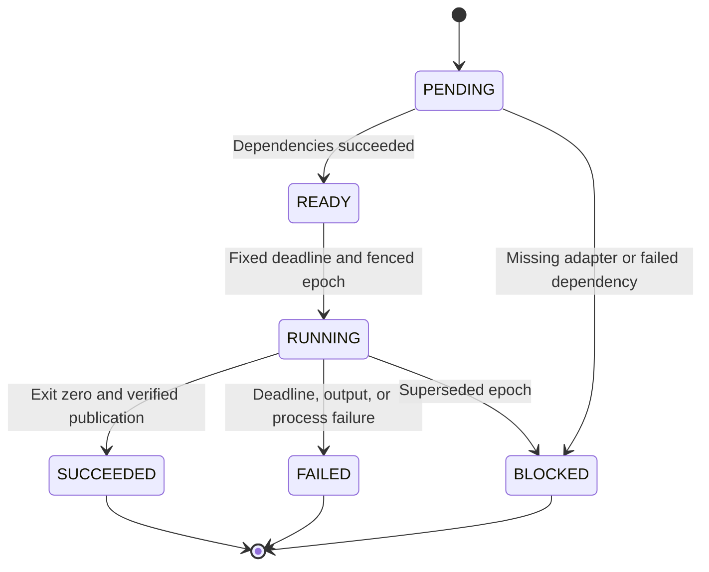
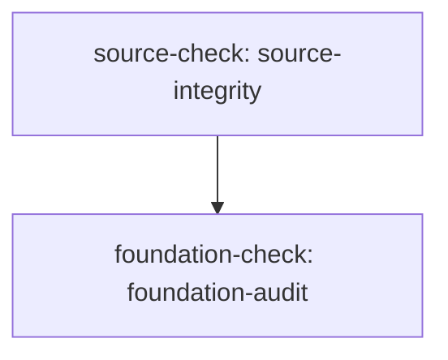

# PHANTOM x Quantum Oracle scientific completion first

Commission: `scientific-completion-20261025`

Source SHA-256: `daffec2608bf1440373afc8734545ee55940c53ce036ea12a99f784b0b550478` (8729 UTF-8 bytes).

Execution and scientific acceptance are separate. Successful adapters prove only their stated checks. Scientific acceptance: **NOT_EVALUATED**.

## Task state machine



## Dependency graph



## Grounded requirements

| Requirement | UTF-8 bytes | Disposition | Tasks | Acceptance |
|---|---|---|---|---|
| section-1 | [284,1182) | TASK | source-check | OPEN |
| section-2 | [1182,2519) | CONTEXT | — | OPEN |
| section-3 | [2519,3173) | TASK | foundation-check | OPEN |
| section-4 | [3173,3907) | CONTEXT | — | OPEN |
| section-5 | [3907,4106) | CONTEXT | — | OPEN |
| section-6 | [4106,4147) | CONTEXT | — | OPEN |
| section-7 | [4147,4182) | CONTEXT | — | OPEN |
| section-8 | [4182,4226) | CONTEXT | — | OPEN |
| section-9 | [4226,4277) | CONTEXT | — | OPEN |
| section-10 | [4277,4340) | CONTEXT | — | OPEN |
| section-11 | [4340,4410) | CONTEXT | — | OPEN |
| section-12 | [4410,4808) | CONTEXT | — | OPEN |
| section-13 | [4808,5544) | CONTEXT | — | OPEN |
| section-14 | [5544,6307) | CONTEXT | — | OPEN |
| section-15 | [6307,7292) | CONTEXT | — | OPEN |
| section-16 | [7292,7928) | CONTEXT | — | OPEN |
| section-17 | [7928,8729) | CONTEXT | — | OPEN |

Unmapped source: 284 bytes in 1 intervals. Exact quotes and all uncovered text remain in `source-map.json`.

## Atlas review

| Domain | Applicability | Status | Reason |
|---|---|---|---|
| logic | APPLICABLE | OPEN | Admission predicates, no unsupported inference; unknown evidence remains unknown. |
| set_theory | APPLICABLE | OPEN | Finite distinct domain IDs, state dimensions and input cardinalities. |
| type_theory | APPLICABLE | OPEN | Coordinate, state, channel, word and address distinctions with rejected composition. |
| arithmetic | APPLICABLE | OPEN | Bounded words, modular wrap and exact independent finite reference. |
| algebra | APPLICABLE | OPEN | Permutation unitaries, Hermiticity, CPTP and affine transformation contracts. |
| order_lattices | APPLICABLE | OPEN | Inherited PHANTOM order obligations remain open beyond finite candidate ordering. |
| combinatorics | APPLICABLE | OPEN | Finite grammar enumeration bounds and all failed candidate identities. |
| graph_theory | APPLICABLE | OPEN | Explicit symmetric coupling graph; layout distances confer no coupling. |
| automata_languages | APPLICABLE | OPEN | Legal research phases, finite candidate grammar, source-bound replay. |
| information_coding | APPLICABLE | OPEN | Byte identity distinct from mathematical equivalence and lossy measurement. |
| geometry | APPLICABLE | OPEN | Separate constant local SPD metric, ambient layout and quantum metrics. |
| topology | APPLICABLE | OPEN | General covers, nerves and nested chart topology remain proposed, not proven. |
| analysis_calculus | APPLICABLE | OPEN | Finite trigonometric function spaces and analytic derivatives. |
| differential_equations | APPLICABLE | OPEN | Finite modal evolution and independently compared dynamics. |
| spectral_harmonic | APPLICABLE | OPEN | Actual Fourier coefficients and norm/convention-preserving translations. |
| probability_statistics | APPLICABLE | OPEN | Born distributions, seeded sampling, finite held-out and null controls. |
| optimization_control | APPLICABLE | OPEN | Finite search order is not unrestricted optimality or hardware control. |
| numerical_analysis | APPLICABLE | OPEN | Independent references, tolerances, finite/shape guards, conditioning. |
| category_composition | APPLICABLE | OPEN | Typed composability alone is not a general functor proof. |
| physics_units | APPLICABLE | OPEN | Explicit units/model regime; dimensionless fixture distinct from measurement. |
| quantum_information | APPLICABLE | OPEN | States, density operators, channels and measurement loss semantics. |
| computation_complexity | APPLICABLE | OPEN | Bounded qubits, matrices, candidates, events and supervised deadlines. |
| metrology_uncertainty | APPLICABLE | OPEN | Calibration and experimental uncertainties remain separate from simulation. |

These domains are a required review checklist, not a claim that all mathematics has been exhausted. OPEN and BLOCKED decisions remain unresolved.

## Execution and resume

From the repository root, use the following command forms, replacing the explicit path placeholders:

```text
python3 tools/commission.py validate --bundle BUNDLE
python3 tools/commission.py run --bundle BUNDLE --runs NEW_RUN_DIRECTORY --repo .
python3 tools/commission.py replay --bundle BUNDLE --runs RUN_DIRECTORY --repo .
python3 tools/commission.py resume --bundle BUNDLE --runs RUN_DIRECTORY --repo .
```

Run directories are append-only evidence containers. Resume validates the bundle, implementation pins, receipts, publication hashes and current Supervisor epochs; it does not reset the commission deadline or silently rerun completed tasks.

The compiler does not install Hermes or a language model. External-agent tasks remain BLOCKED until a separately reviewed adapter is implemented. See `external-envelopes.json` and `docs/COMMISSION_COMPILER.md`.
