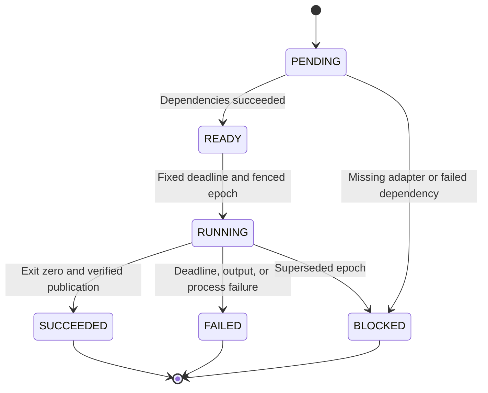
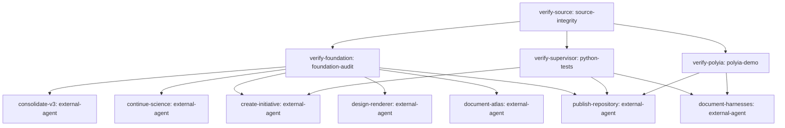

# Surface canonical repository, V3 continuation and directive harness

Commission: `surface-consolidation-20261025`

Source SHA-256: `a11fa2b2730548376fb8f9a7b5bc84c71b1abf1ac3ddeb2f933b85a353117ee0` (5043 UTF-8 bytes).

Execution and scientific acceptance are separate. Successful adapters prove only their stated checks. Scientific acceptance: **NOT_EVALUATED**.

## Task state machine



## Dependency graph



## Grounded requirements

| Requirement | UTF-8 bytes | Disposition | Tasks | Acceptance |
|---|---|---|---|---|
| R01 | [0,37) | TASK | verify-source, publish-repository | OPEN |
| R02 | [39,280) | TASK | verify-source, verify-foundation, publish-repository | OPEN |
| R03 | [281,389) | TASK | verify-supervisor, document-harnesses | OPEN |
| R04 | [521,954) | TASK | verify-foundation, consolidate-v3, continue-science | OPEN |
| R05 | [955,1164) | TASK | design-renderer | OPEN |
| R06 | [1165,1278) | TASK | verify-foundation, consolidate-v3 | OPEN |
| R07 | [1279,1441) | TASK | document-atlas | OPEN |
| R08 | [1443,1771) | TASK | verify-polyia, document-harnesses | OPEN |
| R09 | [1772,2077) | TASK | document-harnesses | OPEN |
| R10 | [2078,2260) | CONTEXT | — | NOT_APPLICABLE |
| R11 | [2262,2343) | CONTEXT | — | NOT_APPLICABLE |
| R12 | [2344,2695) | TASK | verify-foundation, consolidate-v3 | OPEN |
| R13 | [2696,3158) | TASK | create-initiative | OPEN |
| R14 | [3159,3602) | TASK | verify-polyia, document-harnesses | OPEN |
| R15 | [3604,3948) | TASK | verify-supervisor, document-harnesses | OPEN |
| R16 | [3949,4134) | TASK | verify-polyia | OPEN |
| R17 | [4136,4345) | TASK | verify-source, document-harnesses | OPEN |
| R18 | [4346,4750) | TASK | verify-source, verify-supervisor, document-harnesses | OPEN |
| R19 | [4751,4987) | TASK | publish-repository | OPEN |
| R20 | [4988,5043) | CONTEXT | — | NOT_APPLICABLE |

Unmapped source: 155 bytes in 19 intervals. Exact quotes and all uncovered text remain in `source-map.json`.

## Atlas review

| Domain | Applicability | Status | Reason |
|---|---|---|---|
| logic | APPLICABLE | OPEN | Separate source assertions, execution success and scientific admission; preserve counterexamples and open claims. |
| set_theory | APPLICABLE | OPEN | Declare finite state/parameter/domain sets, exact identity and membership; no universal-domain assumption. |
| type_theory | APPLICABLE | OPEN | Require typed source, actions, domains/codomains, addresses and units; reject ill-typed adapters. |
| arithmetic | APPLICABLE | OPEN | Review finite-word carry/overflow, exact rational imports and declared floating encodings. |
| algebra | APPLICABLE | OPEN | State operation laws, inverse/closure conditions and quantum/unitary assumptions with witnesses. |
| order_lattices | APPLICABLE | OPEN | Review dependency partial order and refinement of evidence/permissions; no invented physical order. |
| combinatorics | APPLICABLE | OPEN | Count finite grammar candidates, generated children and search/sample limits. |
| graph_theory | APPLICABLE | OPEN | Validate dependency DAG, chart/coupler graph types and finite node/edge budgets. |
| automata_languages | APPLICABLE | OPEN | Declare control-state transitions, input grammar, guards and accepted/refused execution traces. |
| information_coding | APPLICABLE | OPEN | Exact bytes, hashes, reversible codecs, measurement loss and no unsupported compression claims. |
| geometry | APPLICABLE | OPEN | Distinguish chart-origin layout, physical coordinates, function metrics and quantum ray geometry. |
| topology | APPLICABLE | OPEN | Declare cover/overlap prerequisites; full N-chart topological integration is still open. |
| analysis_calculus | APPLICABLE | OPEN | Declare domains, derivatives, integration measures and regularity before calculus transports. |
| differential_equations | APPLICABLE | OPEN | State initial/boundary conditions, dynamics and solver validity; no new solver validation claimed here. |
| spectral_harmonic | APPLICABLE | OPEN | Distinguish true transforms from same-named view helpers and retain spectrum/polarization semantics. |
| probability_statistics | APPLICABLE | OPEN | Born distributions, finite-shot/measurement uncertainty, null and held-out evidence remain explicit. |
| optimization_control | APPLICABLE | OPEN | Bound search objectives, resource budgets, parent/child control and retry policy. |
| numerical_analysis | APPLICABLE | OPEN | Finite values, normalization, tolerances, stability, phase residuals and independent comparisons. |
| category_composition | APPLICABLE | OPEN | Composition requires typed maps and preservation/loss witnesses; labels alone imply no equivalence. |
| physics_units | APPLICABLE | OPEN | Models need dimensions, material calibration, clocks and coordinate conventions; artistic views are labeled. |
| quantum_information | APPLICABLE | OPEN | Separate basis words, amplitudes, density/channels, measurement, addresses and physical hardware. |
| computation_complexity | APPLICABLE | OPEN | Bound dimension, tasks, bytes, recursion, time and search effort; no unsupported speedup claim. |
| metrology_uncertainty | APPLICABLE | OPEN | Keep exact original measurements/metadata and model/calibration uncertainty distinct from rounding. |

These domains are a required review checklist, not a claim that all mathematics has been exhausted. OPEN and BLOCKED decisions remain unresolved.

## Execution and resume

From the repository root, use the following command forms, replacing the explicit path placeholders:

```text
python3 tools/commission.py validate --bundle BUNDLE
python3 tools/commission.py run --bundle BUNDLE --runs NEW_RUN_DIRECTORY --repo .
python3 tools/commission.py replay --bundle BUNDLE --runs RUN_DIRECTORY --repo .
python3 tools/commission.py resume --bundle BUNDLE --runs RUN_DIRECTORY --repo .
```

Run directories are append-only evidence containers. Resume validates the bundle, implementation pins, receipts, publication hashes and current Supervisor epochs; it does not reset the commission deadline or silently rerun completed tasks.

The compiler does not install Hermes or a language model. External-agent tasks remain BLOCKED until a separately reviewed adapter is implemented. See `external-envelopes.json` and `docs/COMMISSION_COMPILER.md`.
