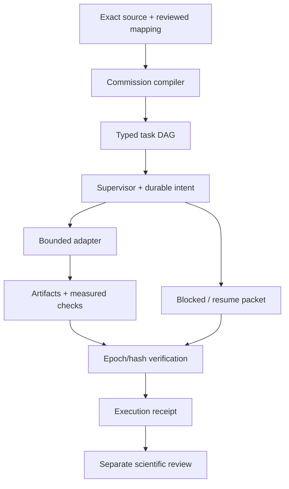

# Architecture, state machines and harness operation

This document describes actual executable layers and the interfaces intended to connect them. [Foundation inventory](FOUNDATION_INVENTORY.md) lists every inspected PHANTOM generator/compiler family; [PolyIA integration](POLYIA_INTEGRATION.md) pins the imported kernels; [compiler guide](COMMISSION_COMPILER.md) specifies the new text compiler. Unimplemented connections are identified explicitly.

## 1. Five distinct layers

| Layer | Actual paths | Responsibility |
|---|---|---|
| Native physical state | `include/surface/physics.hpp`, `src/physics.cpp`, `acoustic.*` | Evolve admitted finite state under declared reduced equations and numerical budgets |
| Observation and interaction | `renderer.*`, `atlas.*`, `input.hpp`, `android/native_main.cpp` | Project state/catalogue into original CPU pixels and sound; receive gestures |
| Native orchestration | `session.*`, `engine_service.*`, `checkpoint.*` | Ordered engine work, snapshots, lifecycle and generation-fenced persistence |
| Scientific references | Materialized PHANTOM/Oracle/V3; `vendor/polyia/` | Original semantics, finite synthesis/compilation, exact reference tests and retained evidence |
| Research control | `tools/commission.py`, `tools/supervise.py`, `tools/new_initiative.py` | Grounded task compilation, bounded host execution, recovery records and independent work paths |

The repository is the integration and evidence plane. The Android application does not run Python, a browser, the whole research corpus or an autonomous LLM. It uses selected native numerical semantics. New reference models need explicit C++ adapters and conformance tests before becoming ink behavior.

## 2. What a state machine means here

A classical machine declares states, input alphabet, guards, transition function/relation and observations. A transition record names before/after state, operation, source identity, domain/codomain, invariants, loss, logical time and evidence. Different machines have different roles:

| Machine | State and transition | Evidence boundary |
|---|---|---|
| Word machine | Bounded unsigned word; inject/invert/assign/add with place/carry trace | `src/phantom.cpp`, `tests/test_phantom.cpp`; original PHANTOM semantics separately retained |
| Circuit reference | Complex amplitude vector and declared basis order; selected ideal gates | Classical numerical state-vector calculation, 1–6 qubits, ≤256 operations |
| Physical solver | Grid/circuit/relay/thermal/acoustic variables; bounded time integration | Equation, units, boundary conditions, solver stability and scoped analytic comparisons |
| Engine service | FIFO View/Paint/Barrier requests, worker state and acknowledgements | Same-build session/checkpoint tests; Android lifecycle still requires device evidence |
| Supervisor | Durable launch intent, epoch, child group, progress, exit classification, publication | POSIX process fault tests and digest-bound committed artifacts |
| Commission | Exact source, reviewed requirements, dependency DAG, allowed tasks, execution receipts and open acceptance gates | Compiler validation and run/replay; no automatic scientific acceptance |
| Research automaton | V3 SCOPE→ACQUIRE→HASH→DECODE→MAP→COMPOSE→SIMULATE→PERTURB→DISCOVER→CHALLENGE→VERIFY→GENERATE→REFLECT→ARCHIVE→SELECT | Full multi-domain automaton remains commissioned; do not conflate the smaller commission runner with this completed system |

For example, 8-bit addition `0x7f + 1` yields `0x80` with carry propagation through the lower seven places. Flipping bit0 of `0x7f` yields `0x7e`. PHANTOM INJECT and INVERT therefore have distinct semantics even though both use a bit address. A representation's closeness in memory is not evidence of physical similarity. [Native contract](PHANTOM.md), [reference functions](FOUNDATION_INVENTORY.md).

## 3. Quantum state and finite classical control

For n qubits, basis indices label `2^n` computational basis states. A complex state vector can occupy coherent superpositions; density operators represent mixed states. A finite controller can select operations on that state, but the continuous amplitudes do not become a finite classical word merely because the controller is an FSM. Native floating-point storage is a declared finite approximation.

Preserve four address types: source byte offset, computational basis index, logical qubit ID, and hardware site/coupler ID. Declare qubit/basis ordering separately from integer endianness. Surface explicitly reorders the original Oracle's q0-most-significant convention and V3's q0-least-significant convention. IBM's own [bit-ordering documentation](https://quantum.cloud.ibm.com/docs/en/guides/bit-ordering) illustrates why integer, diagram and register ordering must be specified.

Measurement is a quantum instrument with classical outcomes and post-measurement state, not an invertible byte codec. Born probabilities, phase, normalization, density positivity, channels and sampling need their own tests. The current native bridge implements ideal pure-state references; full density/channel/provider integration remains open. A complete future hybrid machine needs `(classical_control, quantum_state, clock, calibration, source)` plus guarded unitary/channel/measurement transitions and outcome witnesses. Original Q-Strings are classical relational inference objects and remain separate.

## 4. Parent and child harness contract

The new commission compiler is a finite parent coordinator. Its output identifies tasks, dependencies, source-linked requirements, adapter actions, budgets and acceptance questions. The Supervisor launches one admitted child per task. A task receives a unique stage, epoch and deadline; completed outputs are copied, hashed and published only after the epoch/deadline check. The parent then records execution evidence. Scientific admission is a later explicit review.

Full operational details are in [RECOVERY.md](RECOVERY.md). The crucial limits are actual code: hard budget ≤300 seconds; semantic-progress budget ≤120 seconds; at most one classified retry; retry and progress share the original hard deadline. A heartbeat never refreshes either budget. An unrelated worker cannot publish through an older epoch. Milestones are cooperating-worker assertions; output validation supplies the evidence.

The native worker thread and host Supervisor are distinct. Python can terminate a child process group, but cannot safely kill an arbitrary blocked C++ thread. A whole-host failure also stops a local supervisor. Recovery therefore uses durable records, source custody and a new inspected invocation; it does not claim uninterrupted execution across destroyed infrastructure.

## 5. Compilers and generators actually available

| Family | Produces | Example and limit |
|---|---|---|
| PHANTOM finite synthesis | Typed generator IR from bounded candidate search | Retained affine `(3*x+1) mod256` program, held-out checks and failed candidates |
| PHANTOM compiler | Standalone program specializing a reviewed interpreter with admitted IR | Word/media/support programs; declared word width and wrap/overflow policy |
| PHANTOM support factory | Child generator IR, which can then be compiled | Six retained child pairs; finite supported width/delta family |
| PHANTOM Huffman compiler | Fixed-codec encoder/decoder | Source-dependent compression; no universal compression gain |
| PHANTOM Boolean synthesis | Finite expression/circuit interpreter | Classical truth-table synthesis, distinct from quantum compilation |
| PolyIA generator cards | Admitted protocol or exact polynomial model, then generated candidates | `PING ACK`; 18 exact rational polynomial exercises in the Surface demo |
| PolyIA native compiler | Restricted `.polyia` instructions for a bounded VM | Real emitted source, interpreted output and differential checks |
| University address compiler | Exact rational transformation matrix | Bounded fixture `loom://plate/START/ROTATE:90/SCALE:2/SHIFT:1,0/COMMIT` |
| Surface commission compiler | Machine/tasks/source map/diagrams/manifests from grounded text | This owner's directive, with open language and science retained |
| Surface generator factory | Finite child-generator recipes; each child compiles a later grounded prompt | Depth, child count, action set and task budgets can only narrow |

The complete paths, executable examples, source pins and exact scope are in the linked inventories. A generator-of-generators is a new typed object with its own provenance and independent validation, not permission to edit its parent record. PHANTOM's original factory and Surface's new commission factory are separate grammars with separate acceptance evidence.

## 6. Model-free and external-agent use

Model-free execution is real for the admitted finite grammars and command adapters: exact source checks, selected tests, PolyIA generators, original-reference verification and receipt replay. A novel task without an available adapter stays BLOCKED; bounded search reports exhaustion distinctly from impossibility.

An LLM or Hermes operator can read `AGENTS.md`, consume a source-bound task envelope, work in the initiative worktree and return artifact hashes plus its commands/results. The compiler's external-result path records submission for review, never an invented passing scientific gate. A custom Hermes installation must bind its own tools, budgets and credentials to this protocol; it is not installed or remotely launched by this repository consolidation. Local hashes provide integrity witnesses, not remote identity authentication.

## 7. Entire mathematical atlas review

Every new model/operator/generator needs the ordered project atlas matrix in [MATHEMATICAL_ATLAS.md](MATHEMATICAL_ATLAS.md). Record applicability, obligations, proof versus numerical evidence, counterexamples, input/output maps, units/uncertainty and open dependencies. An irrelevant domain receives a reasoned NOT_APPLICABLE entry; missing analysis remains OPEN. The compiler enforces coverage of the declared domains, while substantive mathematics still requires actual review and tests. This avoids both silent omissions and fictitious universal proofs.
