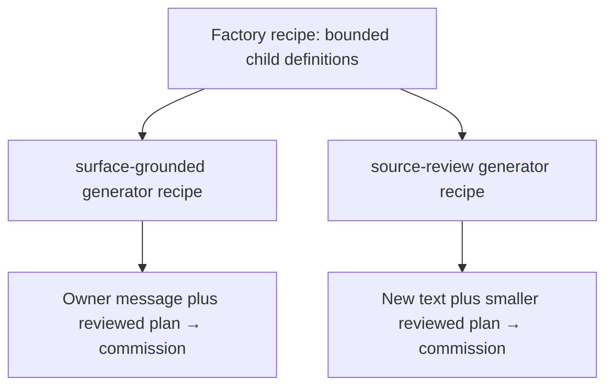

# Grounded commission compiler

`tools/commission.py` turns preserved UTF-8 bytes plus an explicitly reviewed semantic plan into a finite commission. It emits an executable task graph, a standalone SVG, Markdown/Mermaid, a source-map witness, task specifications, external-agent envelopes and an artifact manifest. The model-free runner executes only predefined verification adapters through the existing [Supervisor](../tools/supervise.py).

**Compilation is not unrestricted language understanding.** Arbitrary text can be preserved and drafted. A reviewer supplies the interpretation, dependencies, actions, acceptance gates and atlas applicability decisions. The compiler verifies that these declarations are structurally valid and grounded in exact source bytes; it cannot determine whether the reviewer's interpretation is scientifically or linguistically correct.

**Task success is not scientific ACCEPT.** All generated machines, runtime receipts and imported external submissions carry `scientific_acceptance: NOT_EVALUATED`. The original Quantum Oracle, PHANTOM, V2 and V3 gates retain their own evidence and acceptance requirements.

## 1. Reproduce the owner's commission

The input is the [complete visible message](../commissions/2026-10-25-surface-consolidation/verbatim.txt), paired with its [reviewed plan](../commissions/2026-10-25-surface-consolidation/plan.json). It preserves the visible wording as UTF-8; it does not claim access to the chat transport's original binary encoding.

From the repository root:

```sh
python3 -B tools/commission.py draft \
  --source commissions/2026-10-25-surface-consolidation/verbatim.txt \
  --out build/owner-draft

python3 -B tools/commission.py compile \
  --source commissions/2026-10-25-surface-consolidation/verbatim.txt \
  --plan commissions/2026-10-25-surface-consolidation/plan.json \
  --out build/owner-commission

python3 -B tools/commission.py validate --bundle build/owner-commission
```

Every output directory must be new. Repeating a generation command into an existing directory fails instead of replacing previous evidence. Choose another destination for a fresh experiment. The checked-in generated commission can be validated directly without recompiling it.

`draft` produces syntactic line clauses, exact byte ranges, exact quotes and `UNREVIEWED` statuses. It admits no tasks. For inputs with more than 256 lines, the final draft clause retains the entire remaining suffix. This bounds the draft while preserving all bytes, including CRLF, Unicode, negations and uninterpreted material.

## 2. Reviewed-plan contract

The version-one root object has these fields. Unknown fields are rejected, including a task-level `command` or `shell` field.

| Field | Meaning |
|---|---|
| `schema` | Exactly `surface.commission.plan.v1` |
| `commission_id`, `title` | Stable simple identifier and human-readable title |
| `source` | SHA-256 and exact UTF-8 `byte_length` |
| `review` | `status: REVIEWED` and a nonempty `reviewer` attribution |
| `budget` | Optional `total_seconds` and `max_tasks`; defaults are 900 and 64 |
| `requirements` | Grounded interpretations, dispositions, task links and acceptance gates |
| `tasks` | Allowlisted actions, dependency IDs, source requirement IDs and finite deadlines |
| `atlas_review` | One explicit decision for every domain listed below |

A requirement has this shape:

```json
{
  "id": "retain-source",
  "span": {"start": 0, "end": 15, "quote": "Vérify source."},
  "interpretation": "Verify the retained source bytes.",
  "disposition": "TASK",
  "task_ids": ["check-source"],
  "acceptance": {
    "status": "OPEN",
    "gate": "Independent scientific review remains required",
    "evidence": [],
    "tolerance": "Exact byte identity only; no scientific acceptance implied"
  }
}
```

The displayed example quote occupies 15 UTF-8 bytes. Ranges are half-open `[start,end)` byte ranges, not character indices. The compiler decodes each selected range strictly and compares its exact bytes with the quote. It rejects broken multibyte boundaries, mismatched quotations, wrong digests and wrong byte lengths. Repeated phrases require their actual selected offsets.

`TASK` requirements must name at least one task. `CONTEXT` and `PROHIBITION` requirements admit none. `BLOCKED` requirements may name `external-agent` tasks. Every link is checked in both directions: the task's `requirement_ids` and the requirement's `task_ids` must agree. Overlapping grounded spans are permitted; the source map merges their coverage and retains every uncovered interval as `UNMAPPED`, including whitespace and punctuation.

A reviewed task is declarative:

```json
{
  "id": "check-source",
  "action": "source-integrity",
  "requires": [],
  "requirement_ids": ["retain-source"],
  "timeout_seconds": 60,
  "semantic_timeout_seconds": 30
}
```

Task and requirement IDs are bounded ASCII identifiers. Dependencies must exist and form a directed acyclic graph. The compiler sorts ready task IDs to produce a deterministic topological order. No regular expression or language-model guess admits tasks from the text. A reviewer can make a wrong semantic decision; the format records that decision visibly rather than treating it as a proved interpretation.

Acceptance fields accept only `OPEN`, `BLOCKED` and `NOT_APPLICABLE`. They carry a named gate, evidence references and tolerance. Merely including a reference does not verify its contents. A later scientific review must evaluate the evidence using the original commission's actual gate definitions.

### Atlas review

Each row contains `domain`, `applicability`, `reason`, `evidence` and `status`. Applicability is `APPLICABLE`, `NOT_APPLICABLE` or `OPEN`. Status is `OPEN`, `BLOCKED` or `NOT_APPLICABLE`. A `NOT_APPLICABLE` decision must be consistent in both fields and must have a reason. Evidence references may be empty while work is open.

The ordered checklist is:

```text
logic, set_theory, type_theory, arithmetic, algebra, order_lattices,
combinatorics, graph_theory, automata_languages, information_coding,
geometry, topology, analysis_calculus, differential_equations,
spectral_harmonic, probability_statistics, optimization_control,
numerical_analysis, category_composition, physics_units,
quantum_information, computation_complexity, metrology_uncertainty
```

These 23 domains are the repository's required top-down review checklist. They do not certify that all mathematics has been exhausted. See [the mathematical atlas contract](MATHEMATICAL_ATLAS.md) for the scientific obligations behind the fields.

## 3. Generated artifacts and determinism

| Artifact | Role |
|---|---|
| `source.txt` | Exact input bytes |
| `plan.json` | Canonical reviewed plan, including explicit default budgets |
| `machine.json` | Tasks, dependencies, state transition rules, requirements, atlas decisions and scientific boundary |
| `machine.md` | Human-readable commission, Mermaid state/graph views, review table and resume instructions |
| `machine.svg` | Standalone accessible task-dependency visualization; no browser renderer is required |
| `source-map.json` | Exact selected quotes and every unmapped byte interval |
| `task-specs.json` | Fixed adapter templates and Supervisor budgets/output contracts |
| `external-envelopes.json` | External task descriptions and protocol entry point; runtime-issued envelopes supply concrete run identity |
| `generator.json` | Present when a child-generator recipe produced the commission |
| `manifest.json` | Hash and byte count for every other artifact, plus source and implementation identities |

JSON uses sorted keys, UTF-8, finite numbers and a final newline. Compilations with the same input bytes, reviewed plan, recipe and compiler implementation emit identical bytes. There are no compile-time timestamps, random IDs or absolute workspace paths in the bundle.

The manifest binds both `commission.py` and `supervise.py` by SHA-256. `validate` checks every artifact and regenerates the bundle in memory from its preserved source and plan. Merely changing a diagram and updating one hash cannot make it agree with deterministic regeneration. Retain the matching compiler revision when archiving a bundle: an implementation change requires a new compilation directory.

Hashes detect inconsistency against retained evidence. They are not signatures or authenticated reviewer identities. Someone who deliberately replaces every source, program, receipt and reference can manufacture a different internally consistent history; independent custody, review and Git publication identities remain necessary.

## 4. Bounded local execution

Prepare the foundation first if using its adapter:

```sh
python3 -B tools/materialize_foundation.py
```

If it is already materialized, use its documented `--check` mode. The commission runner never silently re-extracts or replaces a foundation directory.

```sh
python3 -B tools/commission.py run \
  --bundle build/owner-commission \
  --runs build/owner-run-001 \
  --repo .
```

The fixed local adapter set is:

| Action | Actual work | Scope of a successful receipt |
|---|---|---|
| `source-integrity` | Revalidate and deterministically regenerate the complete commission bundle | Source, spans, machine and artifact byte identities agree |
| `python-tests` | `python -B -m unittest discover -s tests -p test_supervisor.py -v` | The existing Supervisor tests passed; the compiler test file is not recursively invoked |
| `polyia-demo` | `python -B tools/polyia_surface_demo.py --output STAGE/polyia-demo.json` | Pinned imported constructs completed their declared demonstration and custody checks |
| `foundation-audit` | `python -B tools/materialize_foundation.py --output REPO/build/foundation --check` | Existing materialized files match their retained materialization receipt |
| `external-agent` | No local process is launched | Always `BLOCKED`; an external proposal can be submitted for independent review |

Commands are built in code as argument arrays. Source text, interpretation fields and submitted evidence never become shell commands. The repository and its predefined adapter implementations are trusted code; this is cooperating-process supervision, not an adversarial-code sandbox.

The hard limits include:

- Source: 1 MiB, valid UTF-8; inputs must be regular files.
- JSON inputs: 8 MiB; duplicate keys and nonfinite JSON constants are rejected.
- Reviewed requirements: 256; tasks: 64; a plan can set smaller limits.
- Per task: at most 300 seconds total and 120 seconds without declared semantic progress. The semantic deadline cannot exceed the hard deadline.
- Whole commission: at most 3,600 seconds, with a fixed original wall-clock and monotonic deadline.
- Retry: at most one retry for the predefined transient exit code 75, within the original task deadline.
- Supervisor logs and published outputs: the existing Supervisor's 8 MiB log, 64 MiB individual output and 128 MiB total output limits.
- Generator factories: at most eight child recipes; no unbounded recursion.

An action's wrapper reports the two ordered milestones `adapter-started` and `adapter-finished`. Heartbeats do not count as semantic progress and cannot renew deadlines. A success requires zero exit, publication before the deadline, verified declared outputs and the current Supervisor fence epoch.

Missing adapters or prerequisites yield `BLOCKED`. A failed or blocked dependency blocks its dependents. The aggregate status `TASKS_SUCCEEDED` refers to execution only; a mission with unresolved external work will remain `BLOCKED`. CLI exit status is zero for valid generation/validation or fully successful local execution, 2 for a refused input, and 3 for a run/replay with blocked, failed, incomplete or expired work.

## 5. Durable receipts, replay and resume

A run directory contains `run.json`, immutable input pins, an append-only journal, task receipts, Supervisor job directories, immutable summary generations and issued external envelopes. Each Supervisor job retains its own journal, logs, resume record, fence epoch and committed publication manifest. Original output directories and receipts are not replaced.

The first durable run-start journal entry binds the full canonical run record, including both original deadlines. Changing `run.json` alone cannot renew the budget. Linked or nonregular evidence-tree entries are rejected before replay or any resumed write; publication also uses exclusive creation. These checks do not claim to defeat a hostile process that can race arbitrary filesystem changes.

```sh
python3 -B tools/commission.py replay \
  --bundle build/owner-commission --runs build/owner-run-001 --repo .

python3 -B tools/commission.py resume \
  --bundle build/owner-commission --runs build/owner-run-001 --repo .
```

`replay --bundle BUNDLE` performs deterministic bundle validation without running tasks. Adding `--runs` also checks runtime receipts, fixed adapter specifications, publication digests, current fence epochs and external submission records. Read-only replay supports relocating evidence: it verifies historical argument arrays against the recorded context and current implementation/input hashes, without executing historical paths. Recreate the materialized foundation first when replaying a run that pinned its receipt.

`resume` retains the original host paths, implementation pins and monotonic-clock identity. It skips tasks with valid terminal receipts. If a process ended after Supervisor publication but before the commission receipt was written, resume reconstructs that receipt from the actual terminal Supervisor record and checks its publication. Unstarted tasks can proceed only within the original remaining budget.

An unfinished Supervisor intent remains `BLOCKED` for host-process inspection. It is not automatically restarted, because the original child may still exist after its supervisor host dies. The Supervisor cannot guarantee cleanup across host death or terminate descendants that deliberately escape their original process group. Do not claim general crash recovery or restart live work blindly. A reviewed new run is a distinct attempt with a new evidence directory.

On a host without a verifiable persistent monotonic-clock identity, read-only replay remains available; resume and external-result reconciliation refuse rather than renew deadlines. The current host implementation uses Linux's boot identity for that check.

## 6. External LLM / Hermes protocol

This repository does not install Hermes, launch an LLM service or claim that either is configured. An operator may supply a task to an existing agent using the JSON protocol. During `run`, each external task gets `RUN/envelopes/TASK_ID.json`, containing:

- Exact commission, task, source, bundle and run identities.
- The canonical task digest and original source requirement spans.
- Submission epoch 1, attempt limit 1 and the original deadline.
- Explicit time, artifact count and byte budgets.
- Allowed capabilities: read supplied immutable inputs, propose reviewable artifacts, and submit hashed evidence for independent review.
- `automatic_execution: false` and `scientific_acceptance: NOT_EVALUATED`.

The envelope is the actual instruction contract. Its capabilities do not install tools or grant unrestricted host access. A language model may interpret and draft proposals; the local reconciler never executes code from those proposals. External work must finish within the issued task deadline, which starts when the run issues the envelope.

After the operator or agent has authored an actual artifact, this example creates a conforming result. `analysis.md` must contain the actual proposed analysis and its limitations, not an invented success claim.

```sh
python3 - RUN/envelopes/TASK_ID.json AGENT_OUTPUT/analysis.md RESULT.json <<'PY'
import hashlib, json, pathlib, sys

envelope = json.loads(pathlib.Path(sys.argv[1]).read_text())
artifact = pathlib.Path(sys.argv[2])
raw = artifact.read_bytes()
result = {
    "schema": "surface.commission.agent-result.v1",
    "commission_id": envelope["commission_id"],
    "task_id": envelope["task_id"],
    "task_sha256": envelope["task_sha256"],
    "bundle_manifest_sha256": envelope["bundle_manifest_sha256"],
    "source_sha256": envelope["source"]["sha256"],
    "run_sha256": envelope["run_sha256"],
    "submission_epoch": envelope["submission_epoch"],
    "outcome": "PROPOSED",
    "summary": "Proposed analysis awaiting independent review",
    "scientific_acceptance": "NOT_EVALUATED",
    "artifacts": [{
        "path": artifact.name,
        "bytes": len(raw),
        "sha256": hashlib.sha256(raw).hexdigest(),
        "command": "Operator-authored analysis; no local execution claimed",
        "observed_result": "The attached analysis was produced for review",
        "tolerance": "Exact artifact bytes only; scientific gates remain open"
    }]
}
pathlib.Path(sys.argv[3]).write_text(json.dumps(result, indent=2) + "\n")
PY

python3 -B tools/commission.py reconcile-results \
  --bundle BUNDLE --runs RUN --repo . \
  --result RESULT.json --artifacts AGENT_OUTPUT
```

The result outcome is `PROPOSED`, `BLOCKED` or `FAILED`. `PROPOSED` requires an artifact. Artifact entries carry path, exact bytes/hash, command record, observed result and tolerance. `command` is audit text only. Up to 32 artifacts, 16 MiB each and 64 MiB total may be imported; paths must be relative, contain at most 16 components, and have no traversal, duplicate names or symlink components.

Reconciliation validates the issued epoch, all identities, the original deadline and actual artifact hashes, then copies the evidence into a new immutable submission directory. A stale or future epoch is rejected. A result claiming `ACCEPT` is rejected. The returned status is **`SUBMITTED_FOR_REVIEW`**. The original external task remains `BLOCKED`, and no scientific gate or local execution status is promoted. Replay exposes submissions separately from execution receipts.

## 7. A factory that generates generators

The [example factory](../examples/commission-factory.json) emits two child-generator recipes. Each emitted child is a reusable constrained compiler recipe that accepts fresh source bytes plus a reviewed plan and produces a commission. A child recipe is not a renamed task.

```sh
python3 -B tools/commission.py factory \
  --recipe examples/commission-factory.json \
  --out build/commission-generators

python3 -B tools/commission.py generate \
  --recipe build/commission-generators/surface-grounded.generator.json \
  --source commissions/2026-10-25-surface-consolidation/verbatim.txt \
  --plan commissions/2026-10-25-surface-consolidation/plan.json \
  --out build/owner-generated-commission

python3 -B tools/commission.py validate \
  --bundle build/owner-generated-commission
```

The actual composition is:



The factory parent includes `allowed_actions`, limits and explicit child definitions. Each child can only narrow its parent's action set and budgets. It embeds its exact canonical parent recipe and parent SHA-256. On generation, the compiler reconstructs the selected child from that parent and rejects altered parent digests, action expansion, budget expansion, duplicate/recursive IDs or impossible depth.

The implemented grammar has a factory at depth 0, child recipes at depth 1 and commissions at depth 2. `max_depth` is an upper bound; no recursive metaprogramming or executable child code is inferred. The example's general child accepts the owner's plan; its smaller `source-review` child accepts only `source-integrity` and `external-agent` plans with at most eight tasks and a 300-second commission budget. A reviewed plan cannot bypass those inherited limits.

This demonstrates finite composition of generators with content-addressed lineage. It does not establish open-ended invention, unlimited generator depth or a proof that arbitrary natural-language instructions have been understood.

## 8. Verification and boundaries

Run the complete Python host suite from the repository root:

```sh
python3 -B -m unittest discover -s tests -p 'test_*.py' -v
```

`tests/test_commission.py` exercises deterministic generation, UTF-8/CRLF grounding, negation and unknown-text retention, review gates, action/DAG/budget rejection, factory inheritance, actual supervised execution, timeout failure, artifact tamper detection, current-epoch fencing, receipt recovery without rerunning, portable replay, fixed run deadlines, blocked external work, operational submissions and linked-evidence rejection. The existing Supervisor suite separately exercises heartbeats, ordered progress, timeout/retry bounds, descendant cleanup and late-publication fencing.

These tests verify orchestration and evidence bookkeeping. They do not close the scientific acceptance matrix, prove an external agent's statements true, provide cryptographic signatures, verify an Android device launch or demonstrate physical quantum hardware. The repository's original scoped scientific evidence remains authoritative for those separate questions.
