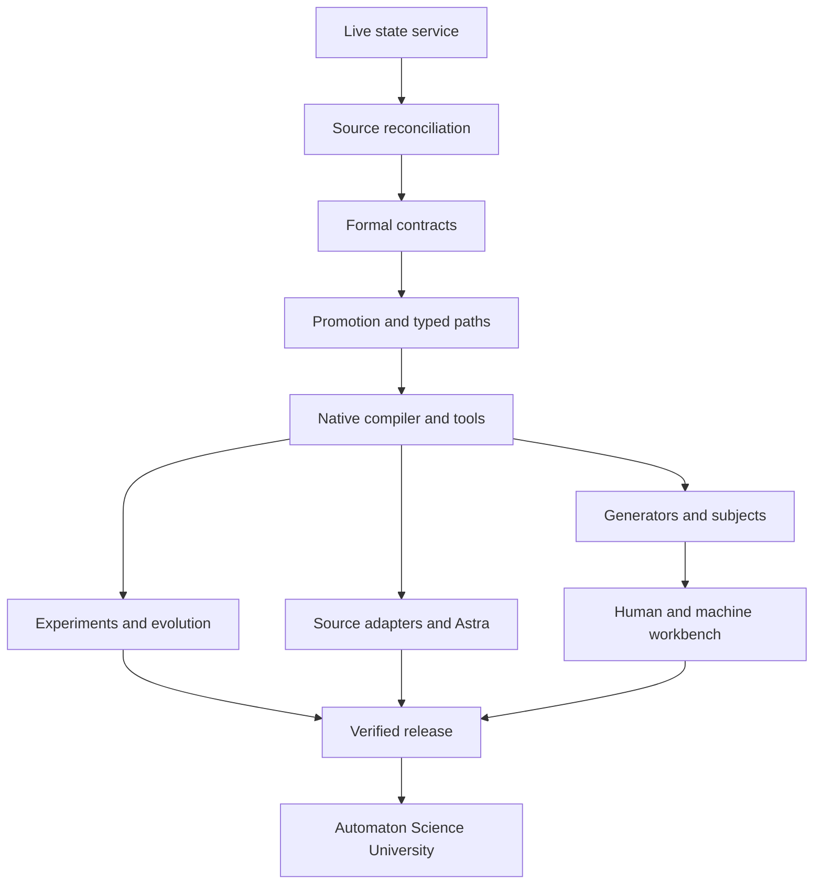

# Acceptance, definitions of done and DODGE work contracts

## Two different completion questions

**This deliverable** is the source-bearing constitutional commission, scientific specifications, complete known-source reconciliation and tested portable bootstrap. **The future Codex mission** commissions the full Poly IA product on the actual target VM. The bootstrap supplies real operational machinery and finite scientific capabilities; it does not claim that every future obligation is already implemented.

`registry/constitution.json` contains 192 full-mission obligations plus BOOT-001 and BOOT-002. The latter prove captured artifact integrity and the registered exact scientific seed respectively. Full-mission obligations initially use the explicit unsupported verifier `commission-evidence`. Codex must implement their actual acceptance adapters; substituting `artifact-integrity` for scientific or operational acceptance is forbidden.

The runtime deliberately retains `commission_status: NOT_COMMISSIONED`, including after a successful demonstration. Extending it to issue a full completion certificate is itself guarded work: the final implementation must evaluate the real mandatory gates, inherited specifics, exceptions and target deployment evidence.

## The acceptance registry

`registry/acceptance.json` defines 23 families and one definition-of-done row for each of the 192 mission obligations. It preserves links to original PolyIA/UCG obligations and their exact retained acceptance text. Supplemental constitutional dispositions remain separately addressable. A family is not completed merely because its specification file exists.

| Family | What must be established |
|---|---|
| Source | Actual attachment/archive/repository/book bytes and complete inherited disposition coverage |
| State | Transactional durable events, replay, typed integrity and recovery |
| Guidance | Distinct receipt, acknowledgement and actual registered effects |
| Evidence | Actual captured artifacts, matching trusted verifier, acceptance and source-linked checkpoint |
| HTTP/UI | Real read/command parity, authentication, revision handling, safe connection behavior |
| Polynomial | Exact finite polynomial/division/derivative identities with domain preservation |
| Promotion | Source expansion and separately scoped semantic preservation |
| Q-path | Genuine joint-premise typed/context-aware composition |
| Native compiler | Real native language, IR, module resolution and executing language/nonlanguage packages |
| Tools | Enforced capabilities, read isolation, effect/retry/uncertainty contracts |
| Models | Constructive generation, state maps, supported explanation and independent packages |
| Mathematics | All inherited subject-specific acceptance and honest conventional/University coverage |
| Chemistry | Scoped constructive form/element/molecule methods and independent evidence |
| Corpus/languages | Exact source strata, variety packs, PHONEX and attested relation types |
| Experiments | Seal-before-witness, supervised bounded workers, failures and reproducibility |
| Evolution | Baselines, regression checks, impact, admission, activation and rollback |
| Astra | Actual ATOM/geometry adapter with semantic/view separation |
| Adapters | Source-grounded bridges to the available canonical projects |
| Intake | Native article/prompt → interpretation → supported improvement → testable opportunity |
| No LLM | No local/remote inference dependency or invocation in required workflows |
| Operations | Actual target service URL, supervision, persistent storage and recovery |
| Release | Evidence-backed finite commissioning certificate and complete handoff |
| University | Standing charters, curriculum/labs and bounded ongoing scientific practice |

Some families have a finite bootstrap implementation and a much broader commissioned extension. The registry states this distinction. Inherited tests reported in source packets are preserved as reported evidence; they do not enter the new release's fresh-pass count unless actually rerun.

## Produce → verify → accept

A work item begins with its obligation version and a DODGE contract. The worker creates real output, then calls PRODUCE with permitted workspace paths. The harness captures immutable bytes and records the producer, path, digest and revision. This is a claim that the bytes exist, not that their contents are true.

VERIFY runs the registered implementation for that obligation. It checks the captured inputs, actual code identity and appropriate positive/negative conditions. Scientific verification binds to the actual tested kernel and evidence, not an arbitrary unrelated attachment. Unknown verifiers remain unsupported. Failure or error is retained and leaves the requirement unaccepted. The verifier cannot obtain success from a caller-supplied Boolean or receipt-shaped JSON.

ACCEPT requires the current produced version's passing receipt and intact captured bytes. Reproduction of a changed artifact invalidates prior current verification. Historical receipts remain available. A new version cannot inherit acceptance simply by retaining the old filename or title.

A checkpoint commits a snapshot plus source/constitution/authority context and retained artifact identities. The state service makes the result inspectable through both HTTP and the web interface. A database commit, Git commit and scientific acceptance receipt are separate objects; production records should link them rather than pretending they are identical.

## Evidence dimensions

| Dimension | Examples | What it does not establish by itself |
|---|---|---|
| Custody | Original bytes, hash, pinned commit/tree | Scientific truth or execution permission |
| Claim kind | Established, house definition, conjecture, application, mythology | Actual implementation/testing status |
| Evidence class | Proof, exact finite check, symbolic check, numeric support, self-consistency | An unbounded guarantee outside stated scope |
| Outcome | PASS, FAIL, REFUSED, INCONCLUSIVE, RESOURCE_LIMIT | Full mission completion |
| Operational status | Produced, verified, accepted, active, superseded | Correctness of a different artifact/version |

“Verified” always names what was checked, by which method and under which assumptions. Empty checks do not pass. Numerical sampling cannot prove an identity over all inputs. A malformed request or exhausted budget is a useful explicit outcome, not an excuse to emit a fabricated answer.

## Required negative controls

Negative evidence is part of every acceptance family, not a decorative appendix. The bootstrap tests already exercise missing inputs, wrong contexts/types, zero division, exact-number budgets, source/receipt/state tampering, duplicate/reused IDs, revision races, invalid guidance order, unsafe paths, unregistered verifiers, unrelated scientific artifacts, unauthorized HTTP, hostile origins and malformed requests. The release report states the tests actually run.

Full commissioning adds native grammar ambiguity, wrong lowering, witness leakage, independent-baseline disagreements, lost external acknowledgements, numerical/domain counterexamples, update regressions, source rights/export violations, stale deployed versions and unsupported article spans. Each failure has a safe diagnostic and a retained version scope.

## DODGE: work contract, not a fixed phase schedule

`registry/work_contracts.json` contains 15 deliverable contracts. Each identifies its production, PIA obligations, prerequisite deliverables, admission guards and acceptance families. Codex may partition, parallelize or rename its phases while keeping those references intact. The service is first after minimum preflight; complete source reconciliation and deeper scientific construction proceed through that service.

The main dependency structure is:



This is a dependency map, not a claim that one field must be fully solved before another can be researched. Ready independent work continues when a specific source, host access or proof is blocked. A blocker retains its reason and exact affected gates.

## Release evidence format

Every actual acceptance receipt records:

```json
{
  "run_id": "stable execution identity",
  "requirements": ["PIA-..."] ,
  "source_context": "captured manifest/constitution/authority identities",
  "command": ["actual", "invocation"],
  "environment": {"runtime": "observed version", "host": "declared scope"},
  "result": "actual outcome and exit code",
  "evidence_class": "the applicable proof/check/observation class",
  "artifacts": [{"path": "retained bytes", "sha256": "actual digest"}],
  "verifier": {"identity": "registered implementation", "sha256": "actual digest"},
  "negative_controls": ["actual controls exercised"],
  "limitations": ["scope and unperformed checks"]
}
```

This is a schema illustration, not a usable success receipt. The bootstrap creates its own actual receipts and release evidence through real executions. Copies or prose assertions do not bypass the command/verifier boundary.

## Final finite certificate

The full mission certificate binds the active constitution and inherited dispositions, source manifest, capability registry, exact accepted package versions, mandatory test runs, no-LLM gate, deployed URL/service checkpoint, recovery evidence and university continuation policy. It lists unresolved scientific questions separately from finite release failures.

A named missing required source cannot be waved through as complete merely because a related document exists. `MISSING-BOOK-OF-FORMS` is preserved until the exact identity is resolved. The owner may make a scoped decision, but the system must record that decision and its consequences rather than silently deleting the obligation.

The post-commission mandate begins after that finite certificate: bounded experiments, reproducible findings, new grammar letters, versioned improvements and source-linked teaching continue through the same inspectable guidance/evidence system.
